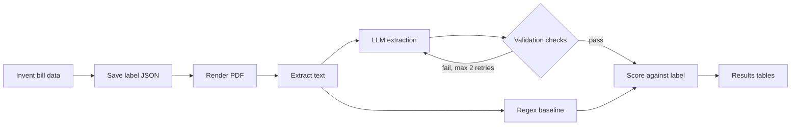

# bill-extractor

Extracts structured data from utility bill PDFs with an LLM and grades it against hand-written regex parsers.

The question: can an LLM replace hand-written bill parsers, and what does that cost? On a 100-bill held-out test set,
the LLM pipeline (Claude Haiku 4.5) got all 1,000 fields right, at $0.0028 and 2.45 s per bill. The regex baseline
was also perfect, but only on the two layouts it was written for. On the three layouts it had never seen, it
recovered under 9% of fields. It never returned a wrong value; it returned nothing.

## Results

100 synthetic bills, 20 per layout, 10 fields each. C / M / W = correct / missing / wrong.

| Template | Baseline layout | Bills | Regex fields C / M / W | Regex bills fully correct | LLM fields C / M / W | LLM bills fully correct |
|---|---|---|---|---|---|---|
| `bordered_table` | seen | 20 | 100.0% / 0.0% / 0.0% | 20/20 | 100.0% / 0.0% / 0.0% | 20/20 |
| `two_column` | seen | 20 | 100.0% / 0.0% / 0.0% | 20/20 | 100.0% / 0.0% / 0.0% | 20/20 |
| `summary_box` | **unseen** | 20 | 4.5% / 95.5% / 0.0% | 0/20 | 100.0% / 0.0% / 0.0% | 20/20 |
| `two_page` | **unseen** | 20 | 8.5% / 91.5% / 0.0% | 0/20 | 100.0% / 0.0% / 0.0% | 20/20 |
| `receipt` | **unseen** | 20 | 4.5% / 95.5% / 0.0% | 0/20 | 100.0% / 0.0% / 0.0% | 20/20 |

| | Regex baseline | LLM pipeline |
|---|---|---|
| Fields correct (of 1,000) | 435 (43.5%) | 1,000 (100.0%) |
| Fields wrong | 0 | 0 |
| Bills fully correct (of 100) | 40 | 100 |
| Line items recovered (of 345) | 135 (39.1%) | 345 (100.0%) |
| Cost per bill | $0 | $0.0028 |
| Latency per bill (mean) | 0.007 s | 2.45 s |
| Validation retries used | n/a | 0 |

The baseline's few correct fields on unseen layouts are fields where the label is empty (no due date, no metered
usage) and the parser also returned nothing. The whole test run cost $0.28.

Full tables, including per-field and validation breakdowns: [`data/results/results.md`](data/results/results.md).

## How it works



The label is written before the PDF exists, and the PDF is rendered from it. Nothing is parsed back out of a PDF to
build a label, so the ground truth can't be wrong.

The LLM step uses structured output against a JSON schema derived from the Pydantic model, so the field docstrings
reach the model as descriptions. Its output is checked for internal consistency (line items sum to the total, dates
in order, and so on). A failed check sends the model its previous answer and the failure message, up to twice.

## Methodology

- **Synthetic bills with known ground truth.** 200 bills across 5 layouts that differ in table structure, total
  wording ("Amount Due", "Balance Owing", ...), date format, credit notation (`-7.33`, `(87.74)`, `26.44 CR`) and
  where the account number sits. Seeded, so every run is identical.
- **Dev/test split.** 100/100, balanced by layout. Prompts and checks were developed on dev bills only. The test set
  was scored once.
- **Three outcomes per field.** Correct, missing (returned null), or wrong (returned a different value). This
  separates loud failures from silent ones.
- **Scoring rules.** Strings are compared case-folded and trimmed; dates and amounts exactly. An empty label matched
  by an empty answer is correct; a value invented where the label is empty is wrong.
- **Line items.** All-or-nothing in the main table, plus an item-level breakdown: recovered, wrong amount, missed,
  invented.

## Design decisions

- **The baseline covers 2 of 5 layouts on purpose.** The other 3 measure how a per-provider parser degrades on a
  format it wasn't built for, which is the real cost of hand-written parsers.
- **The baseline returns null, never a guess.** Every rule is anchored to a printed label. A missing field is
  visible; a wrong one is silent.
- **Money is `Decimal`, not `float`.** Floats can't represent most decimal amounts exactly, and grading needs exact
  equality.
- **Validation checks arithmetic that needs no label.** Line items must sum to the total; dates must be in order.
  These hold for any correct reading of the bill, so the pipeline can catch its own errors in production, where no
  label exists.
- **Test mocks are built from the real SDK signature.** The mock client is autospecced from the installed
  `anthropic` package, so it rejects arguments the SDK doesn't accept. A plain mock once hid a `temperature`
  argument that crashed the real client.

More in [`DECISIONS.md`](DECISIONS.md) and [`src/parsers/README.md`](src/parsers/README.md).

## Limitations

- **Synthetic bills are cleaner than real ones.** Every bill from a template is laid out identically, which flatters
  the regex baseline. Real providers change their layouts over time.
- **`total == sum(line_items)` always holds here.** On real bills it often doesn't, for example when a previous
  balance sits outside the charges table. The sum check would then fire on correct extractions.
- **Validation never fired.** No check failed on any of the 100 test bills, so the retry path is tested only with
  mocks, not under real conditions.
- **A perfect score means the ceiling wasn't reached.** These bills weren't hard enough to find where the model
  fails. It doesn't mean it has no limits.
- **Isolation was at the prompt level.** No prompt was written from test bills, but the coding agent that built the
  project rendered sample PDFs and ran the regex parser across all 200 bills while building it.

## Setup and usage

Requires Python 3.11+ and Homebrew on macOS (other platforms: see the WeasyPrint install docs).

```sh
brew install pango                      # system library WeasyPrint needs to render PDFs
python3 -m venv .venv && source .venv/bin/activate
pip install -r requirements.txt
cp .env.example .env                    # then set ANTHROPIC_API_KEY
```

The results above used Claude Haiku 4.5. The code defaults to `claude-opus-5-5`; to reproduce, set this in `.env`:

```sh
EXTRACTION_MODEL=claude-haiku-4-5
```

Generate the bills. Labels are committed; PDFs are gitignored and regenerate byte-identically from the seed:

```sh
python -m src.generator.cli --count 200 --seed 42 --split
```

Extract one bill by hand (dev-set bills only; the CLI refuses test-set ids):

```sh
python -m src.extraction.cli data/generated/bill_0003.pdf
```

Run the evaluation. Start with a smoke run:

```sh
python -m src.evaluation.run --limit 5      # -> data/results/smoke_results.{json,md}
python -m src.evaluation.run                # -> data/results/results.{json,md}
```

LLM results are cached by bill id in `data/results/llm_cache.json`, which is committed. Rerunning reuses it and costs
nothing. To re-extract from scratch, pass a new cache path, e.g. `--cache /tmp/llm_cache.json`.

Run the tests (no test calls the real API):

```sh
python -m pytest
```

Docker Compose runs PostgreSQL with pgvector (`docker compose up -d`). Nothing uses it yet; it is for the planned
RAG question-answering step.

## Project structure

```
src/schema.py       Pydantic model of a utility bill; the contract every stage shares
src/generator/      Invents bill data, writes labels, renders PDFs through 5 layout templates
src/parsers/        PDF text extraction and the regex baseline (2 target layouts)
src/extraction/     LLM extraction: prompt, API client, validation checks, retry loop
src/evaluation/     Scoring rules, test-set runner with an LLM cache, markdown report
src/storage/        PostgreSQL / pgvector persistence (not built yet)
src/api/            FastAPI app (not built yet)
data/labels/        Ground-truth labels and the dev/test id split
data/generated/     Rendered PDFs (gitignored)
data/results/       Evaluation results and the LLM cache
tests/              Unit tests
```
